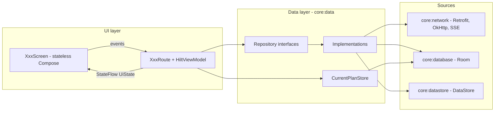
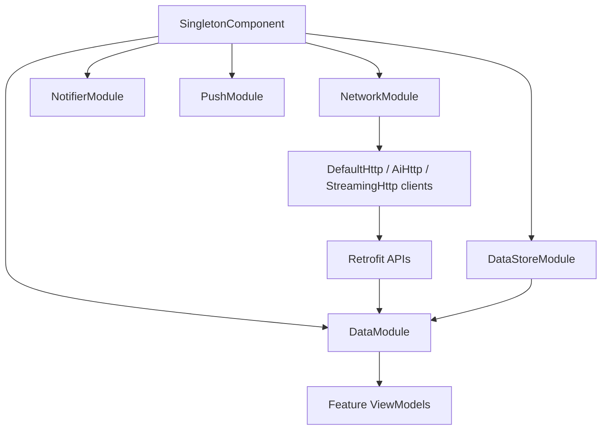
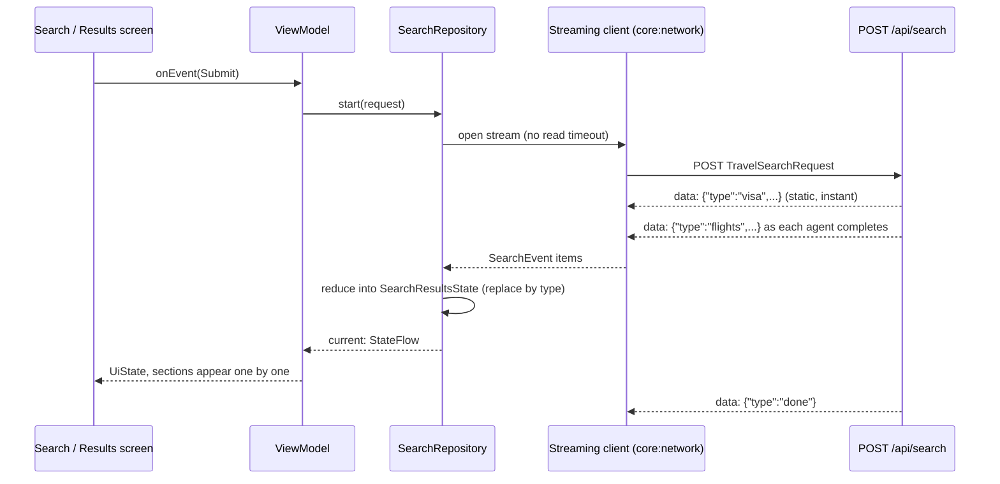

# Architecture

## Layers

- **app** owns the Application, `MainActivity` (`singleTask`), the `NavHost`, the auth gate and the adaptive navigation suite
  (bottom bar on compact windows, rail on medium and expanded).
- **feature:\*** modules contain screens and ViewModels only. They inject repository *interfaces* and never touch Retrofit, DAOs or DataStore.
- **core:data** exposes repositories (all suspend calls return `AppResult<T>`, never throwing except cancellation) and the shared `CurrentPlanStore`.
- **core:model / core:domain / core:common** are pure Kotlin, so logic is unit-testable without Android.

## Unidirectional data flow

Each screen is `XxxScreen(state, onEvent, modifier)`, a stateless composable, plus `XxxRoute` which obtains a
`@HiltViewModel` (`androidx.hilt.lifecycle.viewmodel.compose.hiltViewModel`), collects its `StateFlow<XxxUiState>`
with `collectAsStateWithLifecycle()` and forwards events. UI state is an immutable data class. Navigation out of a
feature goes through lambdas the feature's graph function receives; `app` turns them into routes from
`core:model` (`core.model.navigation`). Features never depend on each other.

## Dependency injection

Hilt (KSP). `app` is the graph root. Modules: `NetworkModule` (three OkHttp clients and the Retrofit APIs),
`DataModule` (repository bindings), `DataStoreModule`, the Room module, `NotifierModule` and `PushModule`, `AppModule`.
`@ApplicationScope` provides the long-lived coroutine scope (draft writes, push registration).

## Data flow of a search stream

`SearchRepository.current` is app-wide, so a running search survives navigation (web parity). The reducer applies
replace-by-type, keeps old data when a later AI result is an error, and retries once if the stream ends without
`done` (sections received before the interruption are kept). See [Networking-and-SSE](Networking-and-SSE.md).

## Where things live

| Concern | Location |
|---|---|
| Interfaces features build on | [Foundation-Interfaces](Foundation-Interfaces.md) |
| Errors | `AppError` sealed hierarchy in `core:common`; backend `detail` is shown as-is |
| Plan draft shared by results, chat and plan screens | `CurrentPlanStore` (`core:data`), persisted to Room |
| Tolerant JSON | `TravelJson` in `core:model`; `RawBacked` keeps original JSON for lossless web round trips |
