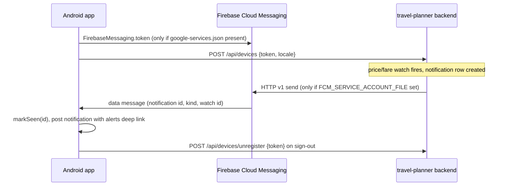

# Notifications and push

Two delivery paths that work together; neither requires the other.

## Channels (`core:notifications`, `TravelChannel`)

| Channel id | Purpose | Importance |
|---|---|---|
| `trip_reminders` | Trip reminders (local) | DEFAULT |
| `price_alerts` | Fare and price-watch alerts | HIGH |
| `nearby_suggestions` | Near me | LOW |
| `account` | Account | DEFAULT |

Channel ids are stable; never rename them. `TravelChannel.createAll` runs in `Application.onCreate`. `Notifier.post(...)` checks
`POST_NOTIFICATIONS` (Android 13+) and that notifications are enabled; every notification opens a `travelplanner://` deep link in `MainActivity`.
The permission is requested in context after the onboarding feature picker, never at launch.

## Deep links

`travelplanner://share/{token}`, `travelplanner://alerts?kind={kind}&watch={watchId}`, `travelplanner://nearby`, plus `plan/{id}` and `chat` declared in the manifest.
Alert notifications link to `alerts?kind=&watch=`, mirroring the web's `/alerts?kind=&watch=`.

## Path 1: polling and local reminders (in place)

`NotificationsInitializer` (started from `TravelPlannerApplication`, off the main thread) wires the background work below while a user is signed in.

- **Alert poll**: `AlertPollWorker` (unique periodic WorkManager work `alert-poll`, network constrained) reads `GET /api/notifications`
  via `NotificationsRepository.unseen`, posts new ones locally and records them with `markSeen` (Room `seen_notifications`). The period is
  30 min, or a 6 h safety net when the server reports `push_configured` and Firebase is set up (`AlertPollIntervals`); the first run gets a
  random initial delay of up to half a period so devices do not poll in lockstep. The first poll after sign-in only sets a baseline (no backlog of old alerts).
  Sign-out cancels the poll.
- **Trip reminders**: `TripReminderScheduler` re-plans one-time WorkManager work from the cached plans whenever they change and after
  `BOOT_COMPLETED` / `MY_PACKAGE_REPLACED`. Device wall clock: 09:00 a week before, 18:00 the day before, 08:00 each trip morning (up to 31 days),
  08:00 on the return day (`TripReminderPlanner`, pure and unit-tested).
- **Near me suggestions** (opt-in in Settings → Notifications): `NearbySuggestionWorker` posts at most one suggestion per 4 h, during a trip
  unless "always" is chosen, using the last location from the Near me screen (no background location permission).
- **In-app inbox**: the bell in the top bar shows the unread count (`GET /api/notifications/unread-count`); `NotificationsRoute` lists, marks read and opens alerts.

Review fixes to the scheduling (capabilities caching, KEEP when unchanged, Retry-After) are in progress in a separate fix pass and may land after this page.

## Path 2: FCM (wired, inert until configured)

- Client: `FirebasePushTokenSource` returns null when Firebase is not initialised; `PushRegistrar` registers the token after every sign-in
  (and app start while signed in) and `TravelMessagingService.onNewToken` on refresh; `onMessageReceived` hands the data-only message to
  `PushAlertHandler`, which marks the id seen first (so the poller will not duplicate it) and posts the alert. A system-shown push from an older
  server carries only a web `link` extra; `MainActivity` maps it to the app deep link. The service is disabled in the manifest unless Firebase is configured.
- Backend endpoints (travel-planner repo, [API-Reference](https://github.com/rupakc/travel-planner/blob/main/docs/API-Reference.md)):
  `POST /api/devices` (register; the app calls it only when its user/token/locale/server fingerprint changes, or weekly), `GET /api/devices`, `DELETE /api/devices/{id}`,
  `POST /api/devices/unregister` (sign-out, idempotent). A token travels only in a request body, never a URL. `/health` reports `push_configured`.
- Backend config: `FCM_SERVICE_ACCOUNT_FILE` (service-account JSON). Without it alerts still appear in-app and by email.
- Dead tokens are pruned by the backend only on definitive FCM rejections.
- Setup steps: [Firebase-Setup](Firebase-Setup.md).
