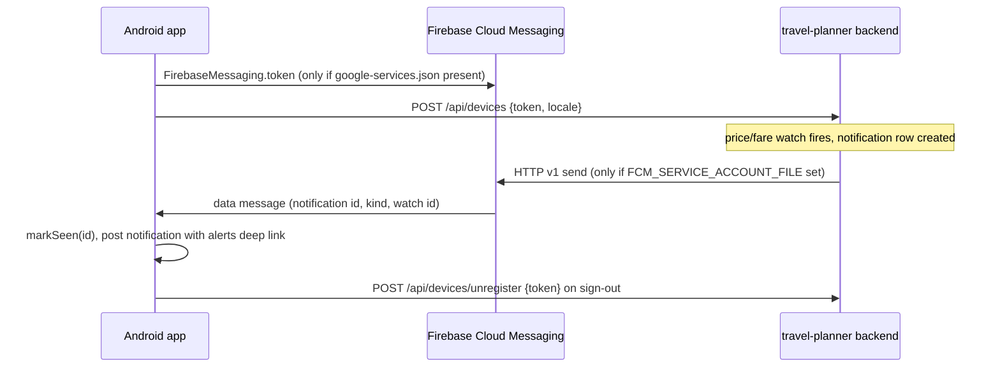

# Notifications and push

Two delivery paths that work together; neither requires the other.

## Channels (`core:notifications`, `TravelChannel`)

| Channel id | Purpose | Importance |
|---|---|---|
| `trip_reminders` | Trip reminders (local) | DEFAULT |
| `price_alerts` | Fare and price-watch alerts | HIGH |
| `nearby_suggestions` | Near me | LOW |
| `account` | Account | DEFAULT |

Channel ids are stable; never rename them. `TravelChannel.createAll` runs in `Application.onCreate`. `Notifier.post(...)` checks
`POST_NOTIFICATIONS` (Android 13+) and that notifications are enabled; every notification opens a `travelplanner://` deep link in `MainActivity`.
The permission is requested in context after the onboarding feature picker, never at launch.

## Deep links

`travelplanner://share/{token}`, `travelplanner://alerts?kind={kind}&watch={watchId}`, `travelplanner://nearby`, plus `plan/{id}` and `chat` declared in the manifest.
Alert notifications link to `alerts?kind=&watch=`, mirroring the web's `/alerts?kind=&watch=`.

## Path 1: polling (works today)

`AlertPollWorker` (WorkManager, planned period 30 min, network constrained, jittered) reads `GET /api/notifications` via `NotificationsRepository.unseen`,
posts new ones locally and records them with `markSeen` (Room `seen_notifications`). With FCM configured the period drops to a 6 h safety net.
Trip reminders are local one-time WorkManager work keyed by plan id (7 days before, 1 day before, each trip morning, last day).
Status: channels, `Notifier` and the repositories exist on `main`; the workers and reminder scheduler are Planned - lands with the notifications/alerts team (spec section 7).

## Path 2: FCM (wired, inert until configured)

- Client: `FirebasePushTokenSource` returns null when Firebase is not initialised; `TravelMessagingService.onNewToken` registers the token;
  `onMessageReceived` marks the id seen first (so the poller will not duplicate it) and posts the alert. The service is disabled in the manifest unless Firebase is configured.
- Backend endpoints (travel-planner repo, [API-Reference](https://github.com/rupakc/travel-planner/blob/main/docs/API-Reference.md)):
  `POST /api/devices` (register, call on every start and token refresh), `GET /api/devices`, `DELETE /api/devices/{id}`,
  `POST /api/devices/unregister` (sign-out, idempotent). A token travels only in a request body, never a URL. `/health` reports `push_configured`.
- Backend config: `FCM_SERVICE_ACCOUNT_FILE` (service-account JSON). Without it alerts still appear in-app and by email.
- Dead tokens are pruned by the backend only on definitive FCM rejections.
- Setup steps: [Firebase-Setup](Firebase-Setup.md).
